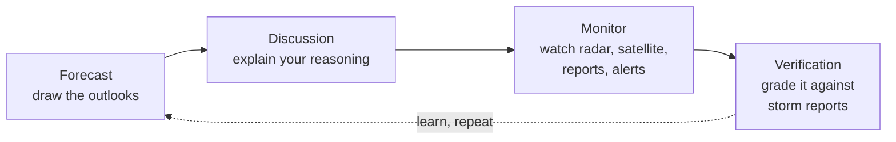
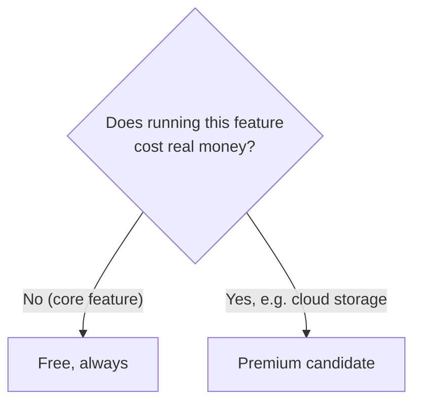

# 1. What GFC is

Graphical Forecast Creator (GFC) is a free, open-source web app where people build severe-weather outlooks like the SPC's, write a discussion, watch the weather unfold, then grade themselves. It exists as a hands-on learning tool, so the **core experience is free forever**.

Live: <https://gfc.weatherboysuper.com> · Desktop-first, with some mobile support.

## The four modes

| Mode | What you do | Main code |
|------|-------------|-----------|
| **Forecast** | Draw/edit/cut polygons for tornado, wind, hail, categorical and Day 4-8 outlooks. Categorical is derived automatically. CIG hatching for significant areas. Days 1-8, named cycles, undo/redo. | `src/pages/ForecastPage.tsx` |
| **Discussion** | Write a text discussion (free-form "DIY" or a guided question flow), preview it, export as `.txt`. | `src/pages/DiscussionPage.tsx` |
| **Monitor** | Radar, satellite, live storm reports, NWS alerts and SPC mesoscale discussions next to your forecast. | `src/pages/MonitorPage.tsx`, `src/monitor/` |
| **Verification** | Load NOAA storm reports for a date, plot them over your outlook, see hit/miss stats per risk level. Isolated from your active cycle. | `src/pages/VerificationPage.tsx` |

There is also an account page (`AccountPage`) for sign-in, billing and cloud cycles.

## Other things you can do

- **Save / load / share**: autosave to the browser every 5 s; export forecast JSON, a map PNG, a ZIP package (JSON + discussion + image), or KMZ.
- **Map styles**: OSM, light/dark CartoDB, satellite, and a flat "weather" style; overlays for states, counties, CWAs.
- **Custom layers and products**: your own categories, colours and hatching on top of the severe layers.
- **Population estimate (beta)**: rough people/cities inside an outlook, using WorldPop. Informational only.
- **Keyboard shortcuts**: `1`-`8` days, `T`/`W`/`H`/`C` outlooks, `G` add TSTM, `Ctrl+S/O/E/D` save / open / export image / dark mode.

## Risk levels at a glance

Probabilities in the tornado/wind/hail layers map to a categorical level. The highest level anywhere in an area wins.

| Level | Name |
|:-:|------|
| 0 | General Thunderstorm (drawn manually) |
| 1 | Marginal |
| 2 | Slight |
| 3 | Enhanced |
| 4 | Moderate |
| 5 | High |

Exact thresholds and examples: [`docs/product/outlook-info.md`](../product/outlook-info.md).

## Free vs premium

Hosting on the VPS doesn't count as a feature cost. Premium exists to offset the extra costs (cloud cycle library, saved custom products). Billing runs through Stripe.

## Disclaimer

GFC is educational and creative. It is **not** an official warning source. Use weather.gov for real decisions.
