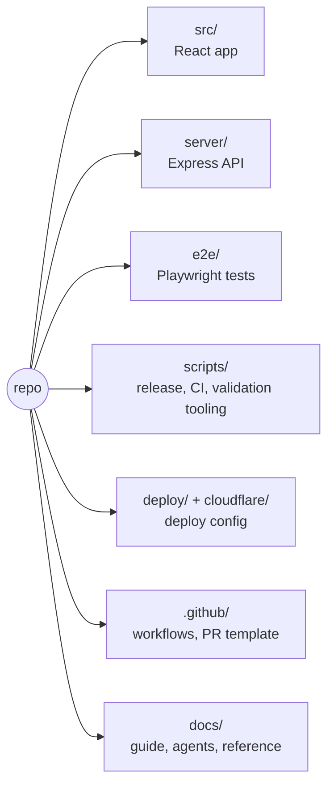
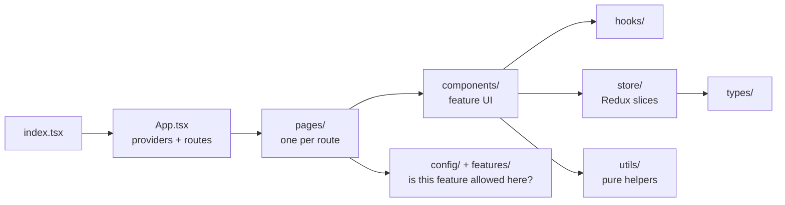

# 2. How the code is organised

## Top-level layout

## Frontend: how a screen is built

| Folder | Role | Should NOT contain |
|--------|------|--------------------|
| `pages` | Compose one route/surface | Reusable domain logic |
| `components` | Feature UI + shared UI primitives | Hidden global state |
| `hooks` | Reusable React workflows (autosave, auto-categorical...) | Routes, server code |
| `store` | Redux slices, selectors | Network calls |
| `utils` / `lib` | Pure logic: geometry, export, grading, persistence | React rendering |
| `monitor` | Monitor data adapters and layer sync | Generic UI |
| `config` / `features` | Build targets, feature gating, navigation | Product behaviour |
| `auth` / `billing` | Sign-in and entitlement clients | Forecast state |
| `types` / `maps` | Shared contracts, map adapter interfaces | Feature code |

Each folder has a short `README.md` next to the code.

## State and persistence

| Data | Where it lives |
|------|----------------|
| Active forecast, verification, overlays, theme | Redux (`src/store`) |
| Autosave / preferences | Browser localStorage |
| Signed-in settings, cloud cycles | Firestore (metadata in `cloudCycles/{id}`, forecast JSON in a `payload` subdocument) |
| Premium status | Stripe is the truth; a server webhook updates entitlements |

Verification state is deliberately **separate** from the forecast, so reviewing an old forecast never touches your active work.

## Server

`server/analytics.js` starts the process; `server/analytics-app.js` wires the routes: metrics, Sentry tunnel, billing, accounts, capability status, Auto-TSTM. Helpers: `server/lib` (capabilities, emergency disable), `server/release` (VPS promote), `server/weather` (TSTM generation).

Rules the server follows: validate input at the route, keep secrets server-side, and **fail closed** when a capability check is unsure.

## Known soft spots

- `src/components` mixes feature UI and shared primitives (the biggest folder).
- Monitor is split between `src/monitor` and `src/monitor/components`.
- The planned fix is gradual: create feature APIs (Forecast, Monitor, Verification, Discussion), then move code behind them, one behaviour-preserving PR at a time. No big-bang moves.

## Where to read deeper

- Forecast workspace routes, state, exports: [`forecast-workspace-boundaries.md`](../architecture/forecast-workspace-boundaries.md)
- Everything else: [`docs/README.md`](../README.md)
