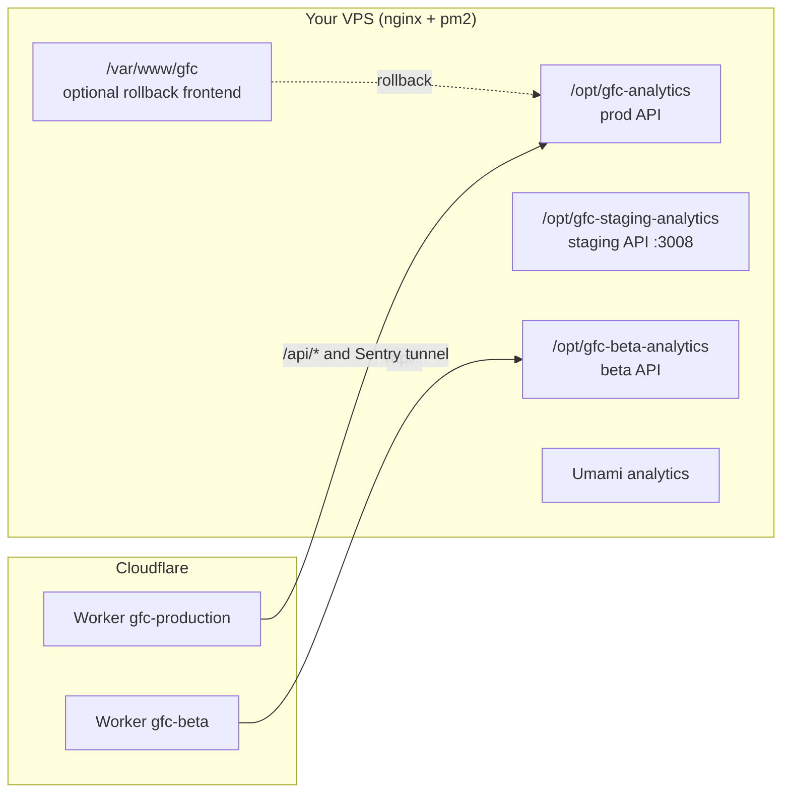

# 3. Hosting and services

## Environments

| Target | URL | Hosted on | Purpose |
|--------|-----|-----------|---------|
| `local` | localhost:3000 | your machine | Development. Works with no credentials. |
| `beta` | beta.gfcweather.com | Cloudflare Worker `gfc-beta` + beta API on the VPS | Open beta: prerelease testing of `main`, open to everyone, existing subscriptions apply. |
| `staging` | staging-gfc.weatherboysuper.com | VPS | Manual rehearsal of any ref before production. |
| `production app` | app.gfcweather.com | Cloudflare Worker `gfc-production` + VPS API | Forecasting, discussion, monitoring, verification, account, and billing. Runs the `stable/2.x` line. |
| `marketing` | gfcweather.com and www.gfcweather.com | Cloudflare Worker `gfc-marketing` | Public marketing pages. `www` redirects to the apex. Legacy app paths redirect to `app.gfcweather.com`. |

> Some older docs and code comments still mention `beta-gfc.weatherboysuper.com`. The Cloudflare config (`cloudflare/wrangler.beta.jsonc`) says `beta.gfcweather.com` is current.

The target is chosen at build time with `VITE_BUILD_TARGET`. It is separate from Vite's mode. Beta is an open deployment, not an access gate.

## Who runs what

Each VPS app directory uses `releases/<version>/` plus a `current` symlink, so a deploy or rollback is just repointing the symlink.

## External services

| Service | Used for | Notes |
|---------|----------|-------|
| **Firebase Auth + Firestore** | Accounts, settings sync, cloud cycles, saved products | Rules live in `firestore.rules`. TTL policies must be set by hand (see below). |
| **Stripe** | Premium subscriptions | The server validates webhooks before changing entitlements. |
| **Sentry** | Errors + performance | Web project and API project. No session replay; PII collection off. Inert without a DSN. |
| **Umami** (self-hosted) | Privacy-conscious usage analytics | One instance, separate website records for prod and beta. Never mix them. |
| **NOAA / NWS / SPC / radar** | Monitor and verification data | Fetched from the browser, normalised before reaching UI. |
| **WorldPop** | Beta population estimate | On-demand, informational only. |
| **Cloudflare** | App, marketing, beta, and feedback sites, plus the feedback Worker (D1) at `feedback.gfcweather.com` | `gfc-production` serves the app and proxies API requests to the VPS. `gfc-marketing` serves the apex and forwards API requests to the app Worker. Deploys run through GitHub Actions. See [beta feedback](../operations/beta-feedback.md). |

## One-time chores that are easy to forget

- **Firestore TTL policies**: `processedStripeWebhookEvents.expiresAt` (30 days) and `adminMetricDedupes.expiresAt` (35 days). Nothing in the repo deletes expired docs; without a TTL policy in each Firebase project they grow forever. Details: [`firestore-retention.md`](../operations/firestore-retention.md).
- **Firestore rules**: deploy and verify per [`firestore-rules-deployment.md`](../operations/firestore-rules-deployment.md).
- **Sentry secrets**: `VITE_SENTRY_DSN`, `SENTRY_DSN`, `SENTRY_AUTH_TOKEN`, `SENTRY_ORG`, `SENTRY_PROJECT` as GitHub Actions secrets.
- **Beta rate limits**: set the same `BETA_WORKER_SHARED_SECRET` in GitHub secrets and the Worker so per-client limits work.
- **Production Worker cutover**: add the new site to Firebase, Google OAuth, Stripe, Sentry, and Umami settings, then follow the ordered [production cutover checklist](../operations/release-workflow.md#production-cloudflare-cutover). The old hostname's page paths redirect at nginx while `/api/*` stays on the VPS.

## Site-wide alert banner

`public/alert-banner.json` is read at runtime. For emergencies edit that file (fields: `enabled`, `message`, `type`, `dismissible`, `linkUrl`, `linkLabel`, optional `startsAt`/`expiresAt`). For timed releases the banner copy lives in `deploy/production-release.json`. See [`alert-banner.md`](../operations/alert-banner.md).

Production Worker assets receive security headers from `public/_headers`. Fingerprinted `/assets/*` files are cached for one year; `version.json` and `alert-banner.json` are not cached. The Worker uses Cloudflare's SPA fallback for direct app routes and keeps `/api/*` on the VPS API origin.

## Privacy and legal

- Policy and terms: [`privacy_policy.md`](../../privacy_policy.md), [`tos.md`](../../tos.md), plus the in-app privacy modal.
- Engineering privacy record for telemetry: [`umami-telemetry-privacy-operations.md`](../operations/umami-telemetry-privacy-operations.md). It is not legal advice.
- Support and privacy-request handling: [`v1.7-support-and-privacy.md`](../operations/v1.7-support-and-privacy.md).
