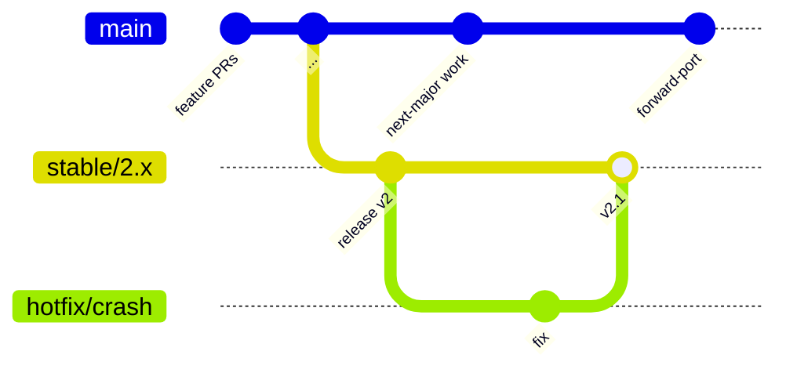

# 4. Shipping code

Nothing deploys just because a PR merged. Releases and deployments are deliberate, manual actions.

## Branch model

| Branch | Role |
|--------|------|
| `main` | Next-major integration line. Normal PR target. |
| `stable/X.x` | Production line for one release family. Frozen except for hotfixes. |
| `hotfix/*` | Urgent production fix, branched from the stable line. |
| `fix/*`, other | Descriptive names only; branch names are not merge gates. |

"Beta" is **not a branch**; it is a prerelease cut from `main`.

GFC displays flat release labels such as `v2` and `v2.1`. Package versions and git tags use padded semver (`2.0.0` and `v2.0.0`); the patch slot stays `0`. Beta versions use `2.0.0-beta.N` with a continuing counter. Hotfixes use the next flat minor label, such as `v2.1`. See [release operations](../agents/release-ops.md#versioning).

## Every PR

1. Open against `main` (or a stable line for hotfixes). CI must pass and it must be reviewed.
2. Declare exactly one changelog decision in the PR body:

| `Changelog-Impact:` | Meaning | You must also |
|---------------------|---------|---------------|
| `beta` | User-visible change landing on `main` | Add an entry under `### Next major / beta` in `CHANGELOG.md` |
| `hotfix` | User-visible change on a stable line | Add an entry under the current stable-line hotfix lane |
| `none` | No public impact | Add `Changelog-Reason:` |
| `inherited` | Forward-port of a stable fix | Add `Port of #123` |

For eligible same-repo PRs, a bot drafts the `beta`/`hotfix` entry for you (see [Automation](06-automation.md)). Dependabot PRs are handled automatically.

3. Use [Conventional Commits](https://www.conventionalcommits.org/): `feat:`, `fix:`, `chore:`, `docs:`, `refactor:`, `style:`.

## Release paths

```mermaid
flowchart TD
  subgraph Beta
    B1["Run 'Release | Beta' on main<br/>(type RELEASE-BETA)"] --> B2[Lint + test + changelog audit]
    B2 --> B3[Bump package.json, tag vX.Y.Z-beta.N, draft prerelease]
    B3 --> B4[Deploy Worker + beta API]
    B4 --> B5[Smoke tests] --> B6[Publish prerelease]
  end
  subgraph Stable["Stable (new major/minor)"]
    S1[Prepare Main Stable Promotion] --> S2[Merge promotion PR to main]
    S2 --> S3[Bootstrap Stable Release Line<br/>creates stable/X.x]
    S3 --> S4[Create Stable Release<br/>from stable branch]
    S4 --> S5[Publishing the release deploys production]
  end
  subgraph Hotfix
    H1[hotfix/* from stable] --> H2[PR into stable + hotfix changelog lane]
    H2 --> H3[Deploy Staging with the hotfix ref]
    H3 --> H4[Merge, then Create Stable Release]
    H4 --> H5[Auto forward-port PR into main]
  end
```

- **Staging** (`Deploy Staging`) is manual, takes any branch/tag/commit, and never runs automatically.
- **Forward-ports**: when a stable PR merges, a bot opens a draft `port/<pr>-to-main` PR. If the diff does not apply, it opens a `porting/conflicts` issue instead. It never merges anything.
- **Beta failures**: do **not** re-run `Release | Beta` (that cuts a new version). Redeploy the existing tag with `Deploy beta to Cloudflare Workers`. Recovery table: [`releasing-beta.md`](../releasing-beta.md).
- **Emergency**: setting `"action": "live"` in `deploy/production-release.json` skips staging.

## Release-note audiences

| Where | Written for | Content |
|-------|-------------|---------|
| `CHANGELOG.md` | Users (feeds website and socials) | Curated, readable |
| GitHub Release | Maintainers | Merged-PR traceability list |

## Workflow cheat sheet

| Workflow file | Purpose |
|---------------|---------|
| `ci.yml`, `pr-governance.yml` | Required checks and changelog-policy gate |
| `release-beta.yml` | Cut and deploy a beta |
| `deploy-beta-workers.yml` | Redeploy an existing ref to the beta Worker |
| `prepare-stable-promotion.yml` | Promotion PR into `main` |
| `bootstrap-stable-release.yml` | Create `stable/X.x` |
| `release-stable.yml` | Create stable or hotfix release (triggers prod deploy) |
| `deploy-staging.yml` | Rehearsal deploy |
| `deploy-main-to-vps.yml` | Production/staging VPS deploy |
| `forward-port-stable-fix.yml` | Stable fix to `main` PR |

Full procedures: [`release-workflow.md`](../operations/release-workflow.md), [`hosted-rollout.md`](../operations/hosted-rollout.md).
