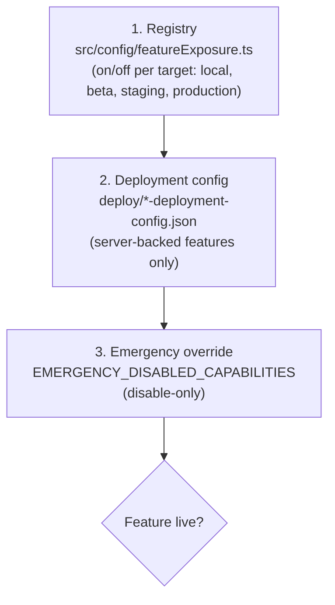

# 5. Feature gating

GFC can hide unfinished or risky features per environment without branching the code. Two layers decide whether a feature is live, and both must agree.

A feature is live only if the registry says yes **and** (for server-backed features) the deployment allows it **and** no emergency override disables it. Everything fails closed.

## What gating covers

| Piece | Behaviour when disabled |
|-------|--------------------------|
| Routes and navbar items | Not registered, not shown |
| Lazy-loaded code | Never loaded |
| Timers, subscriptions, fetches | Never started |
| Server routes | Return `404` with no work done |

## Current registered features

| Feature | Key | Status | Notes |
|---------|-----|--------|-------|
| Auto-TSTM | `autoTstm` | Live everywhere | Server-backed. Cached read-only API. |
| Forecast workflow v2 | `forecastWorkflowV2` | Live everywhere | Home entry + workflow panel |
| Verification relaunch | `verificationRelaunch` | Live everywhere | |
| Custom products | `customProducts` | Live everywhere | Hosted saving also needs premium + Firestore capability checks |
| Tropical workspace | `tropicalWorkspace` | Off | Gates only the legacy `/tropical` route. A new `/forecast/tropical` will get its own key. |
| Collaboration room | `collaborationRoom` | Off | Gated `/collaborate` route |

The registry file is the source of truth; this table can drift. Check `src/config/featureExposure.ts`.

## Auto-TSTM at a glance

- Read-only cached routes: `GET /api/tstm/latest`, `GET /api/tstm/status` (120 req/min/client).
- Users can never trigger generation. A scheduled ingestion loop on the server does that.
- Health check: `GET /api/tstm/status` shows whether ingestion is on and whether Day 1/Day 2 caches are fresh.
- Details: [`auto-tstm-operations.md`](../operations/auto-tstm-operations.md).

## Emergency kill switch

If a server-backed feature misbehaves in production, you can turn it off without rebuilding the frontend:

1. SSH to the API host, edit its `.env`.
2. Set `EMERGENCY_DISABLED_CAPABILITIES=TSTM_GENERATION_ENABLED` (comma-separated for several).
3. To also stop background ingestion: `TSTM_INGESTION_ENABLED=false`.
4. Restart with pm2 (for beta: `pm2 restart gfc-beta-analytics`).
5. Verify via `/api/capabilities/status`; the capability should show `emergency_disabled`.

It can only disable, never enable. Full runbook with verification and rollback: [`emergency-feature-disable.md`](../operations/emergency-feature-disable.md).

## Public status endpoint

`GET /api/capabilities/status` returns only `{ capabilities: { KEY: { available, reason } } }` where reason is `available`, `registry_disabled`, `deployment_disabled`, `emergency_disabled`, or `unknown`. Nothing else is leaked. Schema: [`public-status-schema.md`](../public-status-schema.md).

## Adding or retiring a feature

Short version: register a key, gate routes/nav/side effects *before* the first slice merges, add a disabled-side-effect test, record the tracker issue. Checklist for agents and humans: [`docs/agents/feature-exposure.md`](../agents/feature-exposure.md).
