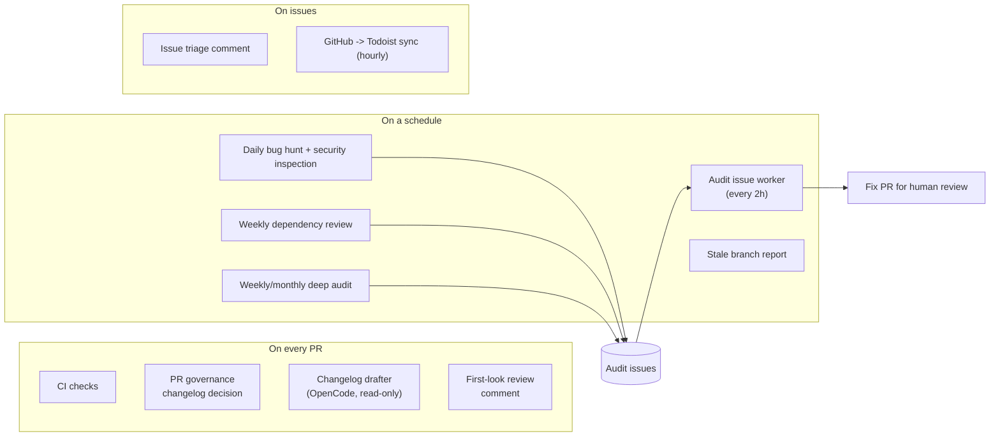

# 6. Automation

A lot of repository housekeeping is done by GitHub Actions. This page is the map. **A human reviews and merges every PR; bots never merge.**

## OpenCode maintenance bots

OpenCode (an LLM CLI, key in `OPENCODE_API_KEY`) runs bounded jobs. It gets **no GitHub token**; deterministic workflow code validates its output and publishes.

| Job | When | Output |
|-----|------|--------|
| PR first-look | PR opened/updated (or comment `/review-opencode`) | One summary comment after CI finishes |
| Issue triage | Non-bot issue opened | Code-backed context or one question |
| Changelog drafter | Eligible PR with `beta`/`hotfix` impact | 1-4 bullets committed to the PR branch |
| Changelog audit | Weekly Friday, and before every release | Correction PR; blocks release until clean |
| Bug hunt | Daily | Up to 3 issues |
| Security inspection | Daily | Up to 3 issues |
| Dependency review | Mondays | Up to 5 issues |
| Weekly / monthly audit | Sunday / 1st of month | Up to 8 / 12 issues |
| Audit issue worker | Every 2 hours | One small fix PR for a low-risk, bot-labelled audit issue |

Guardrails:

- Security, billing, auth, deployment and dependency findings are **never** auto-fixed.
- Only issues authored by `github-actions[bot]` with the exact hidden marker and both labels are picked up, so a public issue cannot inject instructions.
- Tracked `.env` files are removed from the model's checkout.
- To turn jobs off, see "Turning jobs off" in [`opencode-maintenance.md`](../operations/opencode-maintenance.md).

## GitHub -> Todoist sync

Hourly (plus on issue events and manual dispatch), each open issue and ready PR becomes a Todoist task such as `Review PR #42 - title` or `Fix issue #42: title`. GitHub stays the source of truth. The sync **never completes or deletes** tasks, so you tick them off yourself. Routing: Maintenance project by default, Infrastructure for the `infrastructure` label. Needs the `TODOIST_API_TOKEN` secret. Details: [`github-todoist-sync.md`](../github-todoist-sync.md).

## Other automation

| What | Where |
|------|-------|
| Dependabot changelog prep | Trusted `pull_request_target` workflow |
| PR labels (CI, exposure) | `pr-ci-label.yml`, `scripts/lib/pr-labels*` |
| Stale branch report | `stale-branch-report.yml` |
| Port-branch cleanup | `cleanup-port-branches.yml` |
| Local docs site | `pnpm run docs:site` (renders docs to ignored `docs/personal/site`) |
| Local repo inventory | `pnpm run docs:inventory` (ignored output) |
