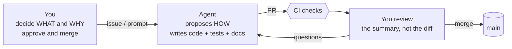

# 7. Working with agents

Most code here is written by agents; you set direction and approve. This page is about doing that well without reading the code.

## Your job vs the agent's job

## Writing a good request

A request is easier to get right when it states:

| Include | Example |
|---------|---------|
| The user problem, not the implementation | "Forecasters lose their work when switching days" |
| What "done" looks like | "Switching back restores polygons; undo still works" |
| What must not change | "Don't touch saved file format" |
| Free or premium? | Use your rule: costs money to run -> premium candidate |
| One issue per request | Extra ideas become separate issues (the repo rule) |

## Reading an agent's PR

You do not need the diff. Ask these five questions of the PR description:

1. **What changed for a user?** (If "nothing", is `Changelog-Impact: none` justified?)
2. **How was it tested?** Look for a real browser/Playwright check for UI, not only unit tests.
3. **Does it touch a risk area?** (table below)
4. **Does it change who sees a feature?** (the "Feature exposure" checkbox)
5. **Did it stay in scope?** Follow-ups should be linked issues, not extra changes.

## Risk areas that deserve a slower look

| Area | Why | Where it lives |
|------|-----|----------------|
| Billing and entitlements | Real money, user trust | `server/billing*.js`, `src/billing/` |
| Auth and account deletion | Data loss, privacy | `server/firebase-auth.js`, `server/account-lifecycle.js` |
| Firestore rules | Who can read/write cloud data | `firestore.rules` |
| Saved file / storage format | Old saves must still open | `src/types/outlooks.ts`, `src/utils/fileUtils.ts`, localStorage keys |
| Feature exposure registry | Controls what ships to whom | `src/config/featureExposure.ts` |
| Release and deploy workflows | Act on the real servers | `.github/workflows/release-*.yml`, `deploy-*.yml` |
| Privacy / telemetry | Legal and trust | Umami, Sentry, `privacy_policy.md` |

Everything else (UI polish, map behaviour, tests) is low blast radius and easy to undo.

## What the safety nets do (and don't) catch

| Net | Catches | Does NOT catch |
|-----|---------|----------------|
| CI (types, lint, Jest, Playwright) | Breakage of tested behaviour | Features nobody tested; "looks wrong" |
| Changelog check | Missing/incorrect user notes | Whether the note is well written |
| Exposure policy check | Un-gated feature leaks | Whether the feature is a good idea |
| Firestore rules tests | Hostile-client data access | Mistakes in new, untested rules |
| Bundle budget | App getting too heavy | Slow runtime behaviour |
| OpenCode first-look | Obvious issues, as a comment | Anything it can't see in the diff |

**Important:** GitHub currently has no branch protection on `main`, so a red check does not physically stop a merge. Look at the check marks before you press merge. Turning on required checks in repo Settings -> Branches is a one-time change worth considering.

## Verifying a change yourself in 2 minutes

1. Open the PR's preview/beta, or run `pnpm run dev` (localhost:3000).
2. Try the exact thing the PR claims to fix, then one neighbouring thing.
3. Reload the page: autosave should bring your work back.
4. Toggle dark mode and shrink the window if it was a UI change.

## When to push back on an agent

- It proposes a new top-level folder, a "shared" bucket, or a big refactor "while it's there".
- It adds a flag, mode, or setting nobody asked for.
- It wants to make a core feature premium. Core is always free.
- It cannot explain the change in plain words.

The repo's own rules back you up: focused PRs, one issue per PR, ask when a rule seems off.
