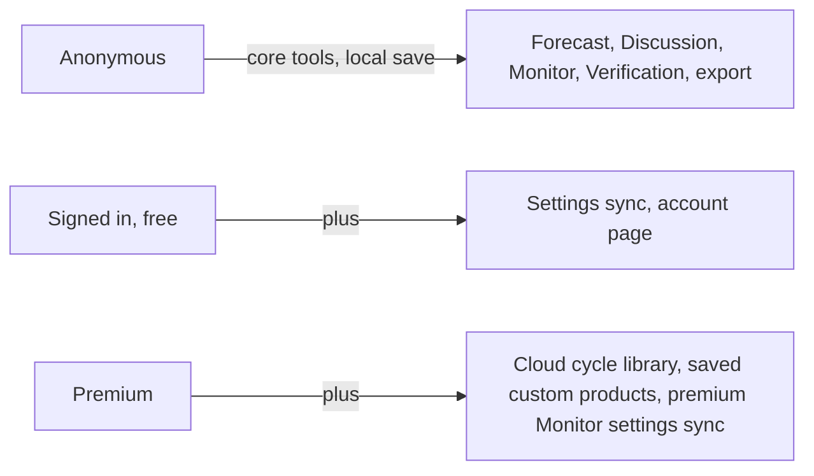

# 8. Product and data reference

A decision-maker's cheat sheet: what exists, who gets it, where data goes, and what it costs to run. Verified 2026-11-08 against v1.8.0-beta.6; the code is the source of truth.

## Pages (what a user can open)

| Page | Path | Needs account? |
|------|------|----------------|
| Home | `/` | No |
| Forecast | `/forecast` (+ workspaces) | No |
| Discussion | `/discussion` | No |
| Monitor | `/monitor` | No |
| Verification | `/verification` | No |
| Pricing | `/pricing` | No |
| Updates (release notes) | `/updates` | No |
| Account | `/account` | Yes |
| Cloud library | `/cloud` | Yes (cloud saving is premium) |
| Admin metrics | `/admin` | Admin allow-list only |
| Beta landing / invite | `/beta`, `/beta-access/...` | Beta site only |

## Who gets what

| Capability | Anonymous | Free account | Premium |
|------------|:-:|:-:|:-:|
| Draw/edit forecasts, Days 1-8, undo/redo | Yes | Yes | Yes |
| Local save/load, exports (JSON, PNG, ZIP, KMZ) | Yes | Yes | Yes |
| Discussion editor | Yes | Yes | Yes |
| Monitor, Verification | Yes | Yes | Yes |
| One-off custom layers (in the file) | Yes | Yes | Yes |
| Settings sync | - | Yes | Yes |
| Cloud cycle library (max 100 cycles) | - | - | Yes |
| Reusable custom products (20 slots) | - | - | Yes |

Price shown in the public billing schema example is $3/month or $30/year; the live values come from Stripe settings, so check the Pricing page for what users actually see. Built-in Rainfall and Tropical AOI styles are available to every tier.

## Where user data lives

| Data | Location | Who can read it |
|------|----------|-----------------|
| Working forecast, preferences | The user's own browser (localStorage) | Only that browser |
| Account profile, settings | Firestore | The user (rules-enforced) |
| Cloud cycles | Firestore (metadata + separate payload doc, <= 750 KB each) | The owner |
| Premium status | Stripe -> server -> Firestore entitlement | Server-written only |
| Usage counts | Server metrics (hashed device/account ids per day) | Admins |
| Page analytics | Self-hosted Umami | Admins |
| Errors | Sentry (no PII, no replay) | Admins |

Account deletion is a server route that removes the user's data.

## What it costs to run

| Item | Notes |
|------|-------|
| VPS | Hosts production, staging, beta API, Umami. "Expected expense"; premium tries to offset part of it. |
| Cloudflare Worker | Beta site only |
| Firebase | Firestore reads/writes grow with cloud users. This is why cloud storage is premium. |
| Stripe | Fees on subscriptions |
| Sentry, OpenCode API | Monitoring and the maintenance bots (key in `OPENCODE_API_KEY`) |
| GitHub Actions | CI and bots; the scheduled audits run daily |

## Moving parts that need occasional human action

| What | When |
|------|------|
| Firestore TTL policies | Once per Firebase project (prod, staging, beta) |
| Rotating secrets | Per your policy; names listed in [agent release ops](../agents/release-ops.md) |
| Alert banner | When you need a site-wide notice (`public/alert-banner.json`) |
| Emergency disable of Auto-TSTM | If it misbehaves ([gating page](05-feature-gating.md)) |
| Triage the bot-opened audit issues | They arrive daily and weekly |
| Approve and merge PRs, run release workflows | Releases never happen automatically |
