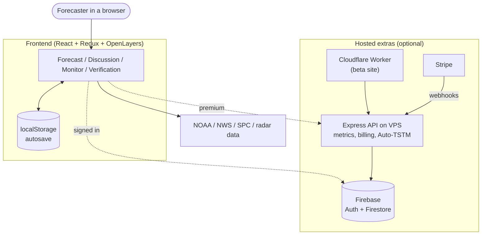

# GFC Guide (for humans)

A readable tour of Graphical Forecast Creator: what it is, how the code is laid out, how it gets shipped, and how the moving parts are kept safe. Read in order, or jump to what you need.

> Looking for the dense, rule-heavy docs that coding agents use? Those live in [`docs/agents/`](../agents/README.md). This guide is the "explain it to me" version.

| # | Page | Answers |
|---|------|---------|
| 1 | [What GFC is](01-what-is-gfc.md) | What does the app do? What are the four modes? What's free vs premium? |
| 2 | [How the code is organised](02-architecture.md) | Where does a feature live? How does data flow? |
| 3 | [Hosting and services](03-hosting-and-services.md) | What runs where (Cloudflare, VPS, Firebase, Stripe, Sentry, Umami)? |
| 4 | [Shipping code](04-shipping-code.md) | Branches, PRs, changelog rules, beta, stable, hotfix. |
| 5 | [Feature gating](05-feature-gating.md) | How features are switched on/off per environment, plus the emergency kill switch. |
| 6 | [Automation](06-automation.md) | The bots and workflows that work on the repo for you. |
| 7 | [Working with agents](07-working-with-agents.md) | How to direct agents, review their PRs, and know what needs a human eye. |
| 8 | [Product and data reference](08-product-and-data-reference.md) | Pages, free vs premium, where data lives, running costs. |
| 9 | [Decisions, open questions, risks](09-decisions-and-risks.md) | Why things are the way they are; what is still undecided. |

## The whole system on one page

Key idea: **everything core works with no account and no server.** Hosted pieces only add cloud storage, premium, and a few server-computed features.

## Glossary

| Term | Meaning |
|------|---------|
| **Cycle** | One saved forecast package (Days 1-8, all outlooks, discussion). |
| **Outlook** | A map layer: tornado, wind, hail, categorical, or Day 4-8 probability. |
| **Categorical** | The overall risk (TSTM, Marginal ... High), auto-derived from the tornado/wind/hail layers. |
| **CIG** | Conditional Intensity Guidance hatching (CIG1-3) for significant threat areas. |
| **Auto-TSTM** | Server-generated general-thunderstorm guidance, cached and read-only. |
| **Custom product** | A user-defined layer style; premium users can save reusable ones. |
| **Exposure** | Whether a feature is visible on a given deploy target. See [Feature gating](05-feature-gating.md). |
| **Build target** | `local`, `beta`, `staging`, or `production`. |
| **Stable line** | A `stable/X.Y.x` branch; this is what production runs. |
| **Lane** | A section of `CHANGELOG.md` a PR must add to (beta lane or stable hotfix lane). |
